# Visor HTML

Web interna para subir archivos HTML (reportes de pandas, Plotly, Jupyter, Bokeh, Folium…), verlos en el navegador y compartirlos con un enlace, sin mandar adjuntos ni montar un servidor por cada reporte.

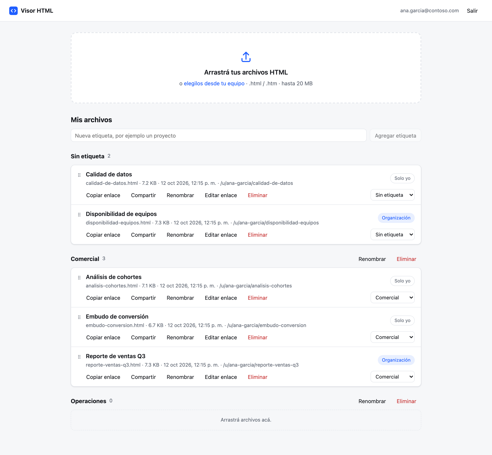

- **Subida por drag & drop** de uno o varios `.html` / `.htm`, con progreso por archivo.
- **Enlaces legibles** y personalizables: `/u/{usuario}/{nombre}`.
- **Visibilidad por archivo**: *Solo yo* u *Organización* (cualquier persona del tenant con el enlace).
- **Enlaces públicos con vencimiento** (1, 7 o 30 días), revocables, para gente sin cuenta.
- **Etiquetas** para agrupar archivos, por ejemplo una por proyecto.
- **HTML aislado**: cada archivo se muestra en un `<iframe sandbox>` servido desde otro origen, así que el JavaScript que traiga no puede tocar la sesión.

El repo tiene dos partes:

| Carpeta | Qué es | Stack |
| --- | --- | --- |
| [html-viewer-api/](html-viewer-api/) | API e infraestructura | Python, FastAPI, Azure Functions, Table + Blob Storage, Bicep |
| [html-viewer-web/](html-viewer-web/) | Frontend | React 19, Vite, TypeScript, TanStack Query, Azure Static Web Apps |

## Contenido

- [Funciones](#funciones)
- [Arquitectura](#arquitectura)
- [Puesta en marcha local](#puesta-en-marcha-local)
- [Pruebas](#pruebas)
- [Deploy en Azure](#deploy-en-azure)
- [Estructura](#estructura)
- [Más documentación](#más-documentación)

## Funciones

Las capturas son de la app corriendo en local, con datos de ejemplo.

### Subir

Se arrastran los archivos a la zona de subida, o se eligen desde el equipo. Cada uno muestra su progreso y su resultado; los que no son HTML o superan el límite (20 MB por defecto) se rechazan con el motivo.

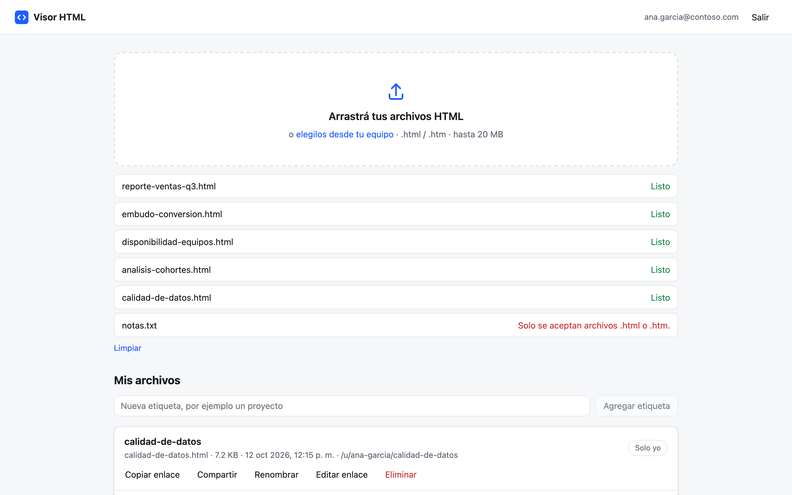

### Ver

El reporte se abre a pantalla completa, con una barra para volver, copiar el enlace o descargar el archivo original.


### Organizar con etiquetas

Cada archivo se arrastra a la etiqueta que corresponda. El selector de la fila hace lo mismo para teclado y pantallas táctiles.

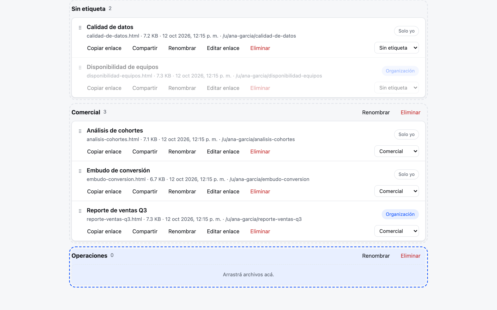

### Compartir

Dentro de la organización alcanza con el enlace interno, que pide login. Para alguien sin cuenta se crea un enlace público con vencimiento, que se puede revocar en cualquier momento.

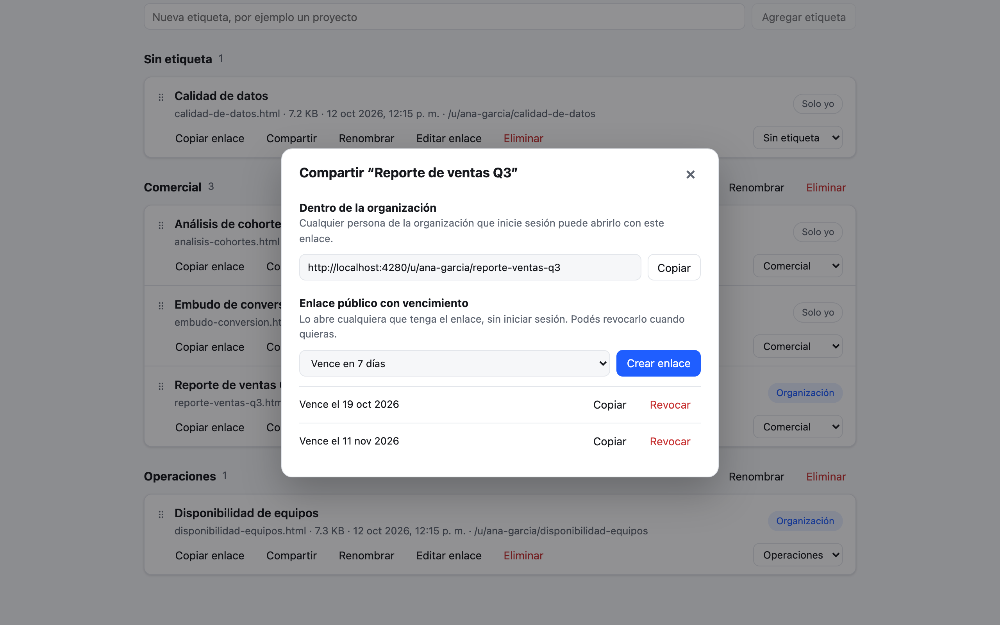

Quien recibe el enlace público ve el reporte sin iniciar sesión. Si el enlace venció o fue revocado, ve un aviso.

| Enlace público | Enlace vencido o revocado |
| --- | --- |
| 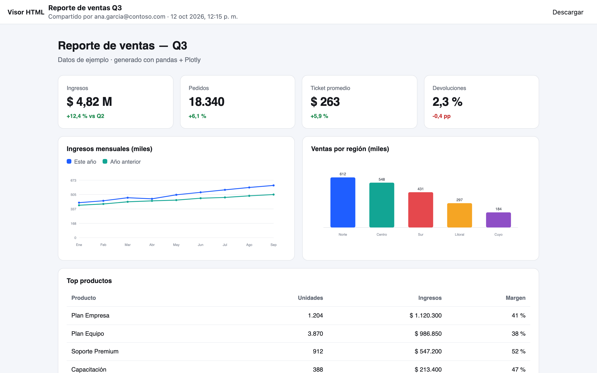 | 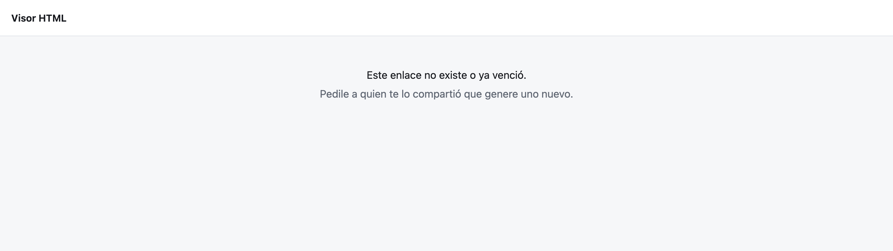 |

### Personalizar el enlace, renombrar y eliminar

Toda acción que pide un dato o una confirmación abre la misma ventana modal; no se usan `prompt`, `confirm` ni `alert` del navegador.

| Editar enlace | Eliminar |
| --- | --- |
| 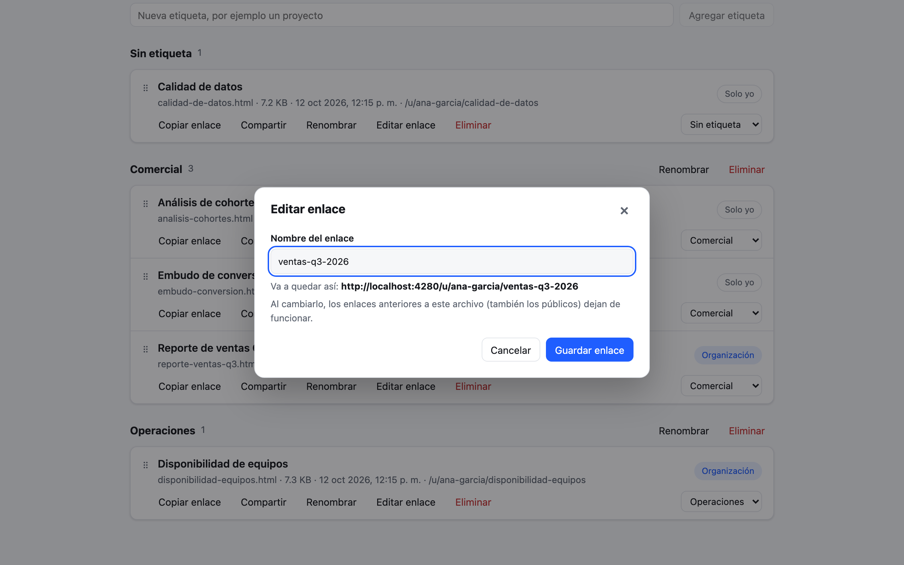 | 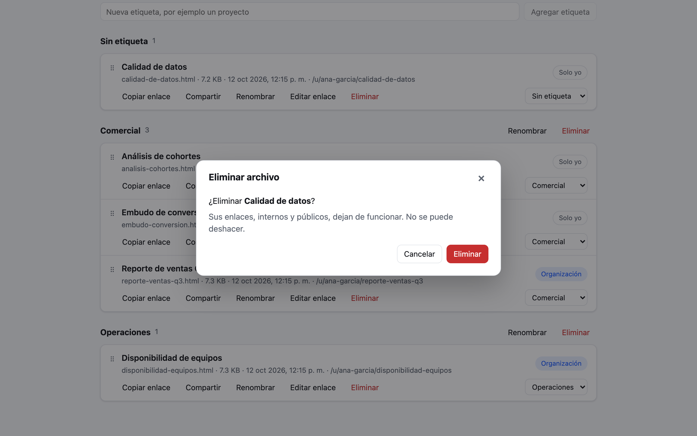 |

### Teléfono y modo oscuro

La interfaz se adapta a pantallas chicas y sigue el tema del sistema.

| Teléfono | Modo oscuro |
| --- | --- |
| 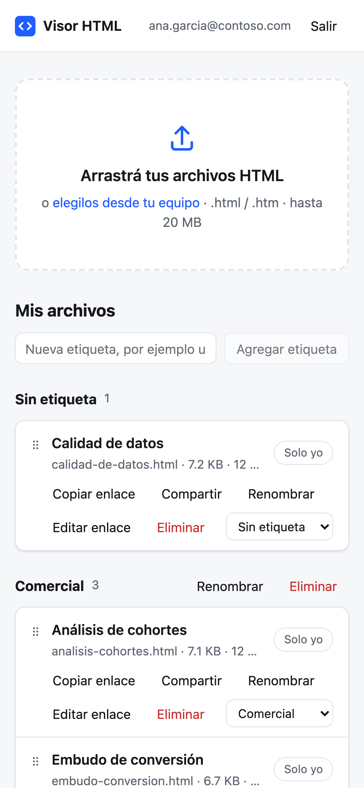 | 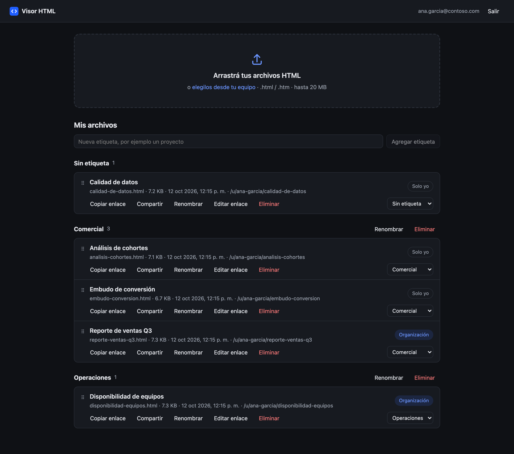 |

### API documentada

Swagger interactivo en `/api/docs`.

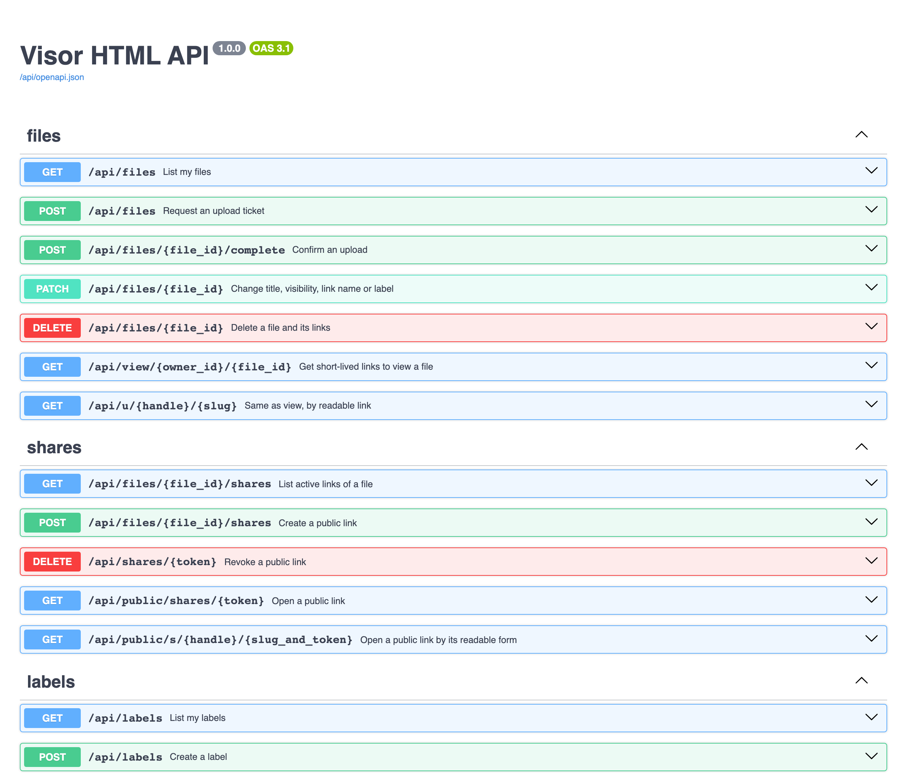

## Arquitectura

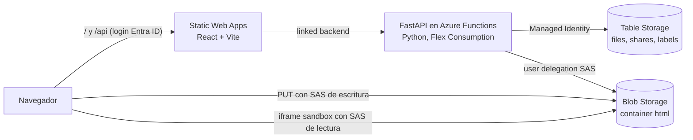

- **Login.** Lo hace Static Web Apps con Entra ID, restringido al tenant. La web llama a `/api/...` en su mismo origen y SWA reenvía cada llamada a la API, así que no hay URL de API que configurar ni CORS hacia la API.
- **Subida.** La web pide un ticket, sube el archivo directo a Blob Storage con una SAS de escritura de 10 minutos y confirma. El archivo no pasa por la Function. Al confirmar, la API verifica el tamaño real y fija `Content-Type: text/html`.
- **Visualización.** La API entrega una SAS de lectura de 10 minutos después de chequear permisos. El HTML se muestra en un `<iframe sandbox>` sin `allow-same-origin`, servido desde el dominio de Blob Storage y nunca desde el de la app.

### Seguridad

| Riesgo | Mitigación |
| --- | --- |
| Un HTML con JavaScript malicioso roba la sesión | Se sirve desde otro origen y en un iframe con origen opaco: sin acceso a cookies, storage ni a la página padre. |
| Claves de storage filtradas | Acceso por clave deshabilitado. Las SAS son *user delegation*, firmadas con la Managed Identity de la Function. |
| Acceso a archivos ajenos | Container privado y una SAS corta por lectura. Los archivos ajenos devuelven 404, así no se puede sondear si existen. |
| Llamadas directas a la Function saltando el login | El *linked backend* de SWA hace que solo SWA pueda invocarla. |
| Archivos enormes | Límite en el cliente, en el ticket y verificación del tamaño real al confirmar. |
| Subidas abandonadas | Job diario que borra tickets pendientes de más de 24 h y su blob. |

El detalle completo está en [html-viewer-api/README.md](html-viewer-api/README.md).

## Puesta en marcha local

Requisitos: Python 3.11+ y Node 20+. No hace falta Docker, una cuenta de Azure ni Azure Functions Core Tools: el storage lo emula Azurite y el login lo emula el CLI de Static Web Apps.

**Terminal 1: API**

```bash
cd html-viewer-api
./start.sh
```

Crea el entorno virtual, instala dependencias, levanta Azurite, crea el container y las tablas, y deja la API en http://localhost:7071 (Swagger en http://localhost:7071/api/docs).

**Terminal 2: web**

```bash
cd html-viewer-web
npm install
npm start
```

Abrí http://localhost:4280 (no el 5173). Aparece un formulario de login falso del emulador: completá un usuario cualquiera, por ejemplo `ana.garcia@contoso.com`.

| Puerto | Qué corre |
| --- | --- |
| 4280 | Emulador de Static Web Apps: la dirección a abrir |
| 5173 | Vite, detrás del emulador |
| 7071 | API |
| 10000–10002 | Azurite (blob, queue, table) |

En Windows, o para levantar cada pieza a mano, ver [html-viewer-api/README.md](html-viewer-api/README.md#desarrollo-local).

## Pruebas

**API** (unitarias con fakes en memoria, HTTP, aislamiento entre usuarios e integración contra Azurite):

```bash
cd html-viewer-api
source .venv/bin/activate
python -m pytest -q                       # unitarias y HTTP
RUN_AZURITE_TESTS=1 python -m pytest -q   # + integración con Azurite (tiene que estar corriendo)
```

**Web** (de punta a punta con Playwright, contra la app real: web compilada, emulador de SWA, API y Azurite):

```bash
cd html-viewer-web
npx playwright install chromium   # solo la primera vez
npm run test:e2e                  # con la API corriendo
```

Las pruebas de punta a punta usan usuarios nuevos en cada corrida y borran lo que crean. Qué cubre cada archivo está en [html-viewer-web/README.md](html-viewer-web/README.md#pruebas).

## Deploy en Azure

1. Registrar la app en Entra ID (una vez).
2. Desde `html-viewer-api`: `./scripts/deploy.sh` crea la infraestructura con Bicep y publica la API.
3. Desde `html-viewer-web`: `./scripts/deploy.sh` compila y publica la web.

Se crean una Static Web App (Standard), una Function App (Flex Consumption) con Managed Identity, el storage de datos, el storage del runtime de Functions, Log Analytics y Application Insights.

Los comandos completos y los parámetros (límite de subida, vencimiento máximo de enlaces, región, dominios extra) están en [html-viewer-api/README.md](html-viewer-api/README.md#deploy-en-azure).

## Estructura

Las dos partes están organizadas por dominio (*screaming architecture*) y usan los mismos nombres: `files`, `shares`, `labels`, `auth`.

```
html-viewer-api/
  app/
    files/  shares/  labels/    Un dominio por carpeta: router, schemas, service, models, ports, repository
    users/                      Nombre de usuario que aparece en los enlaces
    auth/                       Usuario que reenvía Static Web Apps
    storage/                    Blob Storage, firma de SAS, helpers de tablas
    core/                       Settings, errores, composition root
  function_app.py               Entrada en Azure: envuelve la app FastAPI y agrega el job de limpieza
  infra/                        Bicep
  tests/
  start.sh                      Levanta Azurite y la API en local

html-viewer-web/
  src/
    files/  shares/  labels/    Un dominio por carpeta: api.ts, types.ts y componentes
    auth/                       Sesión de Static Web Apps
    shared/                     Cliente HTTP, mensajes, formato y ui/ (ventana modal, iframe aislado)
    app/                        Rutas, layout y página de inicio
  e2e/                          Pruebas de punta a punta (Playwright)
  public/staticwebapp.config.json   Rutas, auth y CSP

docs/screenshots/               Capturas de este README
```

## Más documentación

- [html-viewer-api/README.md](html-viewer-api/README.md): endpoints, enlaces legibles, modelo de datos, decisiones de seguridad, deploy y configuración.
- [html-viewer-web/README.md](html-viewer-web/README.md): relación con la API, estructura del frontend, pruebas de punta a punta y deploy.
