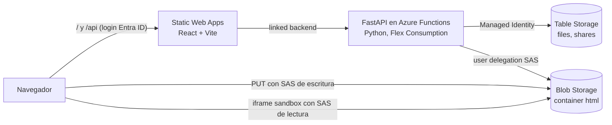

# Visor HTML: API e infraestructura

Backend del Visor HTML: web interna para que los usuarios suban sus archivos HTML (reportes de pandas, Plotly, Jupyter, etc.), los vean en el navegador y los compartan.

Este repo contiene la API (FastAPI, Python) y la infraestructura (Bicep). En Azure la API corre dentro de una Function App; en local, con `uvicorn`. El frontend vive en el repo `html-viewer-web`.

## Arquitectura



**Subida.** El frontend pide un ticket (`POST /api/files`), sube el archivo directo a Blob Storage con una SAS de escritura de 10 minutos y confirma (`POST /api/files/{id}/complete`). El archivo no pasa por la Function. Al confirmar, el backend verifica el tamaño real y fija `Content-Type: text/html`.

**Visualización.** `GET /api/view/{owner}/{id}` devuelve una SAS de lectura de 10 minutos. El HTML se muestra en un `<iframe sandbox>` servido desde el dominio de Blob Storage, nunca desde el de la app.

### Relación con el frontend

La API no valida tokens: confía en el header `x-ms-client-principal` que Static Web Apps agrega después del login. Eso es seguro solo porque el *linked backend* (`infra/modules/swa-link.bicep`) restringe la Function App para que únicamente SWA la invoque. No expongas la API por otro camino sin reemplazar `app/auth/principal.py`.

Qué rutas exigen login se define en `staticwebapp.config.json`, en el repo del frontend: `/api/public/*` es anónimo, el resto de `/api/*` requiere usuario. Si agregás una ruta pública acá, tiene que quedar bajo `public/`.

### Decisiones de seguridad

| Riesgo | Mitigación |
| --- | --- |
| Un HTML con JavaScript malicioso roba la sesión | Se sirve desde otro origen (`*.blob.core.windows.net`) y en un iframe con `sandbox` sin `allow-same-origin`: origen opaco, sin acceso a cookies, storage ni a la página padre. |
| Claves de storage filtradas | `allowSharedKeyAccess: false`. Las SAS son *user delegation* (firmadas vía Entra ID con la Managed Identity de la Function). |
| Acceso a archivos ajenos | Container privado. Cada lectura es una SAS corta generada después de chequear permisos. Archivos ajenos devuelven 404 (no se puede sondear si existen). |
| Llamadas directas a la Function saltando el login | El *linked backend* de SWA restringe la Function App para que solo SWA la invoque. SWA exige login en `/api/*` salvo `/api/public/*`. |
| Usuarios de otros tenants | Proveedor Entra ID personalizado con issuer de tu tenant; GitHub y otros proveedores deshabilitados. |
| Archivos enormes | Límite en el cliente, en el ticket y verificación del tamaño real al confirmar (una SAS no puede limitar tamaño). |
| Subidas abandonadas | Job diario que borra tickets pendientes de más de 24 h y su blob. |

## Estructura

Organizada por dominio (*screaming architecture*): cada carpeta de `app/` es una funcionalidad y contiene todas sus capas.

```
app/
  main.py               App FastAPI: routers, manejo de errores, health
  files/                Archivos HTML: subir, listar, ver, renombrar, borrar
    router.py             Endpoints
    schemas.py            Entrada y salida JSON (Pydantic)
    service.py            Casos de uso
    models.py, ports.py   Dominio e interfaces, sin tipos del SDK de Azure
    repository.py         Adaptador de Table Storage
  shares/               Enlaces públicos con vencimiento (mismas capas)
  labels/               Etiquetas con las que cada usuario agrupa sus archivos (mismas capas)
  users/                Nombre de usuario que aparece en los enlaces (handle)
  auth/                 Usuario que reenvía Static Web Apps
  storage/              Blob Storage, firma de SAS, helpers de tablas
  core/                 Settings, errores, composition root, reloj, slugs
function_app.py         Entrada en Azure: envuelve la app FastAPI (ASGI) y agrega el job de limpieza
tests/                  Unitarios (fakes en memoria), HTTP (TestClient), aislamiento entre usuarios e integración contra Azurite
infra/                  Bicep: main.bicep + modules/ (incluye la Static Web App)
start.sh                Levanta todo en local
scripts/dev_setup.py    Prepara Azurite para desarrollo local
scripts/deploy.sh       Deploy de infra y API
docker-compose.yml      Azurite en Docker (opcional)
```

## API

| Método | Ruta | Acceso |
| --- | --- | --- |
| `GET` | `/api/files` | Mis archivos |
| `POST` | `/api/files` | Pedir ticket de subida `{fileName, sizeBytes}` |
| `POST` | `/api/files/{id}/complete` | Confirmar subida |
| `PATCH` | `/api/files/{id}` | `{title?, visibility?: "private" \| "org", slug?, labelId?}` (`labelId: null` quita la etiqueta) |
| `DELETE` | `/api/files/{id}` | Borra blob, metadata y enlaces |
| `GET` | `/api/view/{ownerId}/{id}` | Dueño, o cualquiera del tenant si es `org` |
| `GET` | `/api/u/{usuario}/{slug}` | Lo mismo, por enlace legible |
| `GET` / `POST` | `/api/files/{id}/shares` | Listar / crear enlace público `{expiresInDays}` |
| `DELETE` | `/api/shares/{token}` | Revocar enlace |
| `GET` | `/api/public/shares/{token}` | Anónimo |
| `GET` | `/api/public/s/{usuario}/{slug}-{token}` | Anónimo, por enlace legible |
| `GET` / `POST` | `/api/labels` | Listar / crear etiqueta `{name}` |
| `PATCH` / `DELETE` | `/api/labels/{id}` | Renombrar / eliminar (los archivos quedan sin etiqueta) |
| `GET` | `/api/public/health` | Anónimo |

Documentación interactiva (Swagger): `/api/docs`.

### Enlaces legibles

- **Interno** (pide login): `/u/{usuario}/{slug}`. `usuario` sale una sola vez del correo con el que se ingresa (la parte antes de la `@`, por ejemplo `emmanuel-reynoso`) y no cambia más; si dos personas coinciden, la segunda recibe `-2`. `slug` sale del nombre del archivo, es único por usuario y el dueño lo puede cambiar. Al cambiarlo, el enlace anterior deja de funcionar.
- **Público** (anónimo, con vencimiento): `/s/{usuario}/{slug}-{token}`. La parte legible es solo informativa: lo que da acceso son los 12 caracteres aleatorios del final (unos 71 bits). Saber el usuario y el nombre del archivo no alcanza.
- Los enlaces anteriores por id (`/view/...`, `/share/...`) siguen funcionando.

### Datos

Cada cambio a un archivo se escribe solo si nadie lo modificó desde que se leyó (ETag); si no, se relee y se reaplica. Así dos cambios simultáneos al mismo archivo (dos pestañas, dos acciones seguidas) no se pisan, y un cambio que llega tarde no revive un archivo borrado.

Los archivos guardados antes de que existieran los enlaces legibles reciben el suyo la primera vez que su dueño los lista o los modifica.

Tablas en Table Storage: `files`, `shares`, `labels` (PartitionKey = usuario dueño), `slugs` (usuario + slug → archivo; crear la fila es el chequeo de unicidad) y `users` (handle ↔ id de usuario). Un usuario solo lee y escribe dentro de su propia partición.

## Desarrollo local

Requisitos: Python 3.11+ y Node 20+ (Node solo para Azurite, el emulador de Azure Storage). No hace falta Docker ni Azure Functions Core Tools.

```bash
./start.sh
```

Crea el entorno virtual, instala dependencias, levanta Azurite, lo prepara y deja la API en http://localhost:7071 (Swagger en http://localhost:7071/api/docs).

A mano, o en Windows:

```bash
# Terminal 1: storage local
npx --yes azurite@3 --silent --skipApiVersionCheck --loose --location .azurite

# Terminal 2: API
python -m venv .venv && source .venv/bin/activate   # Windows: .venv\Scripts\activate
pip install -r requirements-dev.txt
cp .env.example .env
python scripts/dev_setup.py        # container, tablas y CORS en Azurite
uvicorn app.main:app --env-file .env --port 7071 --reload
```

Para usarla desde el navegador, levantá el frontend desde `html-viewer-web` con `npm start` y abrí http://localhost:4280.

**Con Docker (alternativa).** Si preferís Azurite en un contenedor: `docker compose up -d azurite`. `./start.sh` detecta que el puerto 10000 ya está en uso y no levanta otro.

**Con Functions Core Tools (opcional).** Para probar el mismo empaquetado que corre en Azure: `cp local.settings.example.json local.settings.json && func start`. Usá Python 3.11 o 3.12.1+: el worker de Functions no arranca con 3.12.0.

Tests:

```bash
python -m pytest -q                       # unitarios y HTTP
RUN_AZURITE_TESTS=1 python -m pytest -q   # + integración con Azurite: todos los endpoints por HTTP con storage real,
                                          #   SAS reales, cambios simultáneos y filas con formato viejo
```

## Deploy en Azure

1. **Registro de la app en Entra ID** (una vez):

   ```bash
   az ad app create --display-name "Visor HTML" --sign-in-audience AzureADMyOrg --enable-id-token-issuance true
   export ENTRA_CLIENT_ID=<appId de la salida>
   export ENTRA_CLIENT_SECRET=$(az ad app credential reset --id $ENTRA_CLIENT_ID --years 1 --query password -o tsv)
   ```

2. **Infra y API**:

   ```bash
   export RESOURCE_GROUP=rg-html-viewer
   ./scripts/deploy.sh
   ```

   Crea los recursos, configura el redirect URI en el registro de Entra ID y publica la API. Al final imprime el nombre de la Static Web App.

3. **Web**: desde el repo `html-viewer-web`, con el mismo `RESOURCE_GROUP`, correr su `./scripts/deploy.sh`.

Recursos que se crean: Static Web App (Standard), Function App (Flex Consumption) con Managed Identity, storage de datos, storage del runtime de Functions, Log Analytics y Application Insights.

### Configuración (`infra/main.bicepparam`)

| Parámetro | Default | |
| --- | --- | --- |
| `maxUploadMb` | 20 | Si lo cambiás, ajustá también `VITE_MAX_UPLOAD_MB` al buildear la web. |
| `shareMaxDays` | 30 | Vencimiento máximo de enlaces públicos. |
| `staticWebAppLocation` | eastus2 | SWA solo existe en algunas regiones; el contenido igual se sirve desde el edge global. |
| `extraAllowedOrigins` | `[]` | Agregá tu dominio propio si le ponés uno a la web. |

## Próximos pasos posibles

- **ZIP con assets**: aceptar un `.zip` con HTML + imágenes/CSS, descomprimirlo en `{owner}/{id}/` y servir `index.html`.
- **Dominio propio para el contenido** (`content.tuempresa.com`) con Front Door delante del container, vía `PUBLIC_BLOB_BASE_URL`.
- **Event Grid** sobre `BlobCreated` en lugar del paso de confirmación, si querés que la subida no dependa del cliente.
- **Carpetas o etiquetas** y búsqueda por título.
